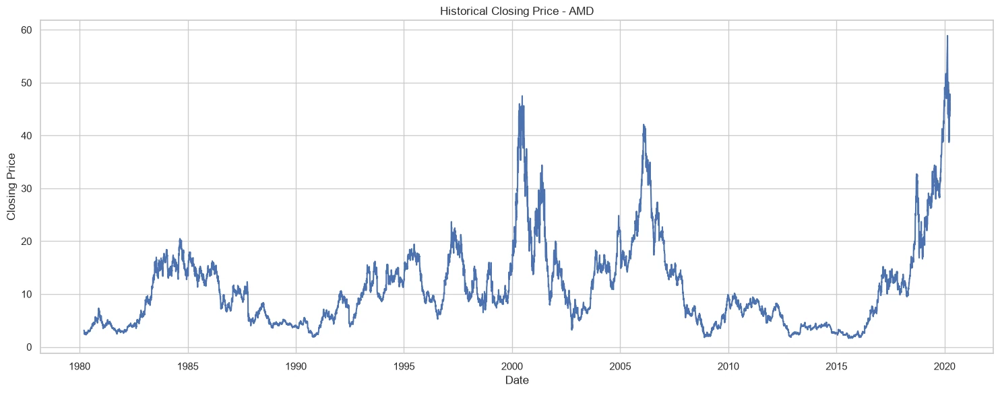
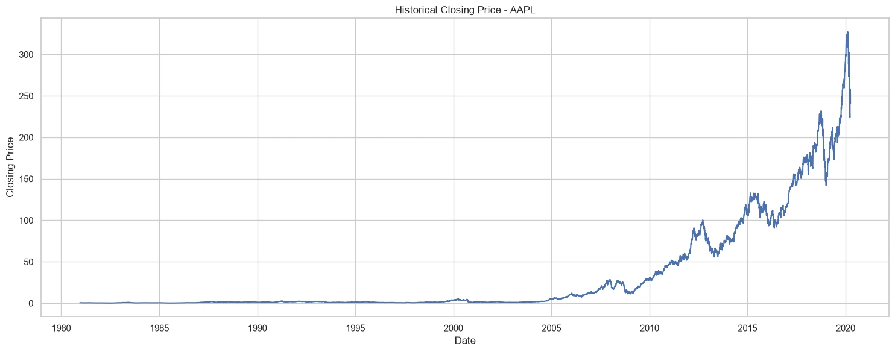
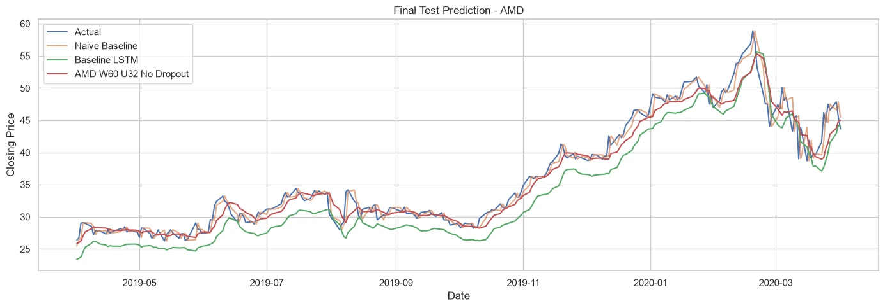
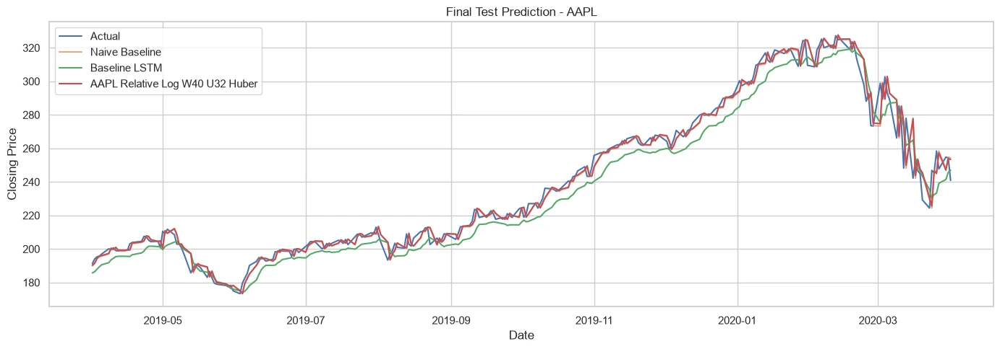

# Stock Price Forecasting with LSTM — AMD & AAPL

**Individual academic Deep Learning project | Time-series forecasting | Python, TensorFlow / Keras, scikit-learn**

## Overview

This repository documents a controlled comparison of **baseline LSTM**, **validation-selected modified LSTM**, and **naive last-close forecasting** on two independent stock-price histories: Advanced Micro Devices (AMD) and Apple (AAPL). Rather than treating a good-looking prediction plot as sufficient evidence, the analysis tests whether complex sequence models improve on a simple, demanding price-persistence benchmark.

## Datasets and experiment design

| | AMD | AAPL |
| --- | ---: | ---: |
| Historical rows | 10,098 | 9,909 |
| Train | 8,859 | 8,689 |
| Validation | 985 | 966 |
| Final held-out trading sessions | 254 | 254 |
| Final test dates | 2019-04-01 to 2020-04-01 | 2019-04-01 to 2020-04-01 |

The modeling target is **daily Close**, ordered by trading date. The train/validation/test split is chronological, with **no shuffle**. Scalers are fitted **only on training data**, and validation/test input sequences include preceding historical context. Model selection uses validation results; final error metrics are computed on the original price scale. The test interval includes the early COVID-19 market shock.

## Modeling methodology

- **Naive forecast:** predict the next Close using the previous trading day's Close.
- **Required baseline:** a 5-session window, LSTM(50, activation=`relu`), then Dense(1).
- **AMD modified model:** 60-session window, 32-unit LSTM, no dropout, Huber loss (validation-selected).
- **AAPL modified model:** relative-log target around the last observed Close, 40-session window, 32-unit LSTM, Huber loss (validation-selected).

AMD and AAPL were evaluated independently, not mixed into one training set.

## Verified held-out test metrics

| Asset | Forecast | RMSE | MAE | MAPE |
| --- | --- | ---: | ---: | ---: |
| AMD | Naive last close | **1.3745** | **0.9112** | **2.4435%** |
| AMD | Baseline LSTM | 3.2348 | 2.9075 | 8.1176% |
| AMD | Modified LSTM | 1.8757 | 1.3268 | 3.4720% |
| AAPL | Naive last close | 6.2818 | 3.8313 | 1.5693% |
| AAPL | Baseline LSTM | 8.6425 | 7.3481 | 3.0325% |
| AAPL | Modified relative-log LSTM | **6.1952** | **3.8172** | **1.5670%** |

**Interpretation:** AMD's modified LSTM is markedly better than its original LSTM, but **worse than the naive forecast**. AAPL's modified LSTM beats naive RMSE by only about **1.38%** on this particular holdout. Neither result establishes profitability or future trading advantage.

## Original result figures

| AMD | AAPL |
| --- | --- |
|  |  |
|  |  |

Other charts are in [`figures/`](figures/), including chronological splits and test RMSE comparisons.

## Repository contents

- [`notebooks/amd_aapl_lstm_forecasting.ipynb`](notebooks/amd_aapl_lstm_forecasting.ipynb): a **source-cell reconstruction from the original Jupyter HTML export**, preserving the notebook's Python cells and explanatory sections; saved execution outputs are intentionally omitted.
- [`reports/original_notebook_export.html`](reports/original_notebook_export.html): the **user-provided full notebook HTML export** with its displayed outputs and explanations, retained as the primary source of evidence.
- [`figures/`](figures/): visual evidence extracted from user-provided notebooks/reports.
- [`requirements.txt`](requirements.txt): suggested dependencies (not an exact historical environment lock).

**Source authenticity:** the native `.ipynb` was not provided. The `.ipynb` above was reconstructed from the HTML export for source readability; it is **not represented as the exact original notebook file** and has not been re-executed in this packaging step. For the definitive historical outputs, consult the saved HTML export.

## Reproduction

1. Obtain the same AMD and AAPL historical CSVs, respecting their provenance/license, and place them at `data/AMD.csv` and `data/AAPL.csv`. Optional source metadata is expected at `data/symbols_valid_meta.csv`.
2. Install dependencies: `python -m pip install -r requirements.txt`.
3. Launch Jupyter Lab or Notebook and open `notebooks/amd_aapl_lstm_forecasting.ipynb`.
4. Run cells in the original notebook order with the appropriate working directory; notebook paths may require running from the repository root.

The underlying source CSVs and trained model checkpoints are **not included**. Minor environment/version or notebook path adjustments may be needed to reproduce the 2026 results.

## Limitations

Close prices are highly autocorrelated; next-close errors do not measure direction-prediction skill. The experiments use only the univariate Close history, one final-year holdout, and no transaction costs. Past data are not financial advice.

## Portfolio case studies

- [AMD — LSTM versus Naive Forecasting](https://hazel-portfolio-rose.vercel.app/projects/amd-lstm)
- [AAPL — Relative-Log LSTM Forecasting](https://hazel-portfolio-rose.vercel.app/projects/aapl-lstm)
